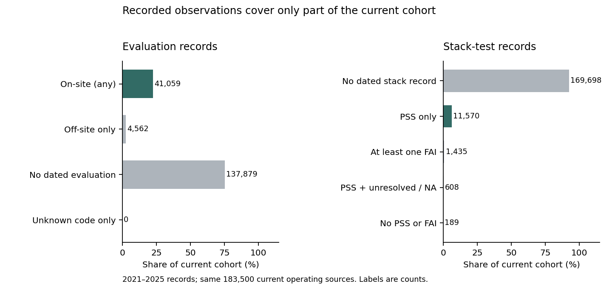

# Know where inspection labels are missing

**Check the training labels before trusting an inspection risk model.** In this captured cohort of **183,500 current operating air sources**, only **13,613 (7.4%)** have a recorded pass or fail stack-test result during 2021–2025. Another **169,698** have no dated stack-test record in that window. A missing national record cannot supply a passing outcome.

**Practical use:** find the groups that need source reconciliation before model development. The [complete data-review list](results/data_review_groups.csv) orders state and source-class groups by the number with no recorded stack test. It directs a data-quality review, not facility inspections or enforcement. State and class lists overlap and must not be added together.



## What the counts establish

- **41,059** sources have an on-site evaluation recorded in 2021–2025; **4,562** have only off-site evaluations. **137,879** have no dated evaluation in this source/window.
- Coverage differs by current source class. Among major sources, 11,382/13,548 have an on-site evaluation and 5,754/13,548 have an observed stack-test result. For minor sources, those counts are 13,544/135,345 and 2,995/135,345. Required reporting and testing differ; this is not an estimate of risk or regulatory performance.
- The stack-test categories retain **1,435** sources with at least one recorded FAI, **11,570** with only PSS, **608** with PSS plus unresolved/NA/unknown tokens, and **189** with records but no PSS or FAI. Of the FAI group, **1,213** also have PSS records. A historical failed test does not establish current noncompliance.

The useful conclusion is a data requirement: establish the required-test universe and comparable outcomes before treating missing records as labels. A stack test, an on-site evaluation and an off-site review are different observations. National absence may reflect reporting rules, state-only records, source-system delay or no event; this audit cannot identify which explanation applies.

## Scope and evidence

The fixed protocol precedes one official EPA ICIS-Air bulk download. It contains 280,423 facility rows, 1,824,426 evaluation rows and 658,331 stack-test rows. The cohort uses current operating status and the fifty states plus DC; all five calendar years use that same current cohort. Entry dates, historical operating status and original publication vintages are unknown. These are current-snapshot recorded-coverage counts, not historical national inspection rates or a complete census of required tests.

The export's evaluation dates use a different delimiter from the dictionary. The initial parser rejection is retained privately; the documented correction leaves the cohort, windows and code categories unchanged. Results are a **corrected retrospective descriptive audit**. No risk model, calibration, propensity correction, protected predictive test, improved detection or realized benefit is claimed.

Public data retain minimal factual source tokens and full SHA256 keys in 29 gzip shards; the raw archive and identity mappings remain private. Hashes do not guarantee anonymity. No owner/contact/address fields or separate formal-publication projects are included. See [data use and limits](DATA_RIGHTS.md).

## Inspect and reproduce

The [protocol](PROTOCOL.md), [capture manifest](data/source_manifest.json), [source reconciliation](data/source_verification.json), [complete source audit](results/source_audit.json), [facility-window counts](results/facility_windows.csv.gz) and [all 354 group summaries](results/group_counts.csv) make the denominators inspectable. Figures show [class differences](figures/class_coverage.png) and [all annual comparisons](figures/annual_coverage.png).

```text
python -m pip install -r requirements.txt
python src/verify_source.py
python src/verify_results.py
python src/reproduce.py
python src/verify_figures.py
python src/verify_paper.py
python src/verify_canonical_git.py
```

The source check reconciled 39,720,857 assertions against the private original through an independent Pandas reader. Public replay checks hashes/schema; it cannot prove unavailable originals. Separate SQL reconstruction verifies 1,101,000 facility-window rows and every group summary. Seventeen hand-authored fixtures cover dates, identity conflicts, duplicates, missing records and mixed outcomes. Synthetic fixtures are excluded from research counts. These finite checks do not establish complete reporting, a valid selection model or production readiness.

**Next step:** reconcile coverage with state/local records, document required monitoring and label definitions, and design an evaluation that addresses how observations were selected. Measure actual review effort and findings before claiming operational value.
